<div align="center">

# 🤖 YAX PICKR · 파티션 칸별 적재 Pick & Place

**PAC 2026 Physical AI Challenge · 분과① 효림엑스이 미션 · PICKR Lab**

비전으로 상자·파티션·뽁뽁이 블록을 인식하고, WeGo **PiPER** 로봇팔로 블록을 빈 칸에 하나씩 넣은 뒤<br>
**스스로 성공/실패를 판정해 재시도**하는 피드백 루프 시스템


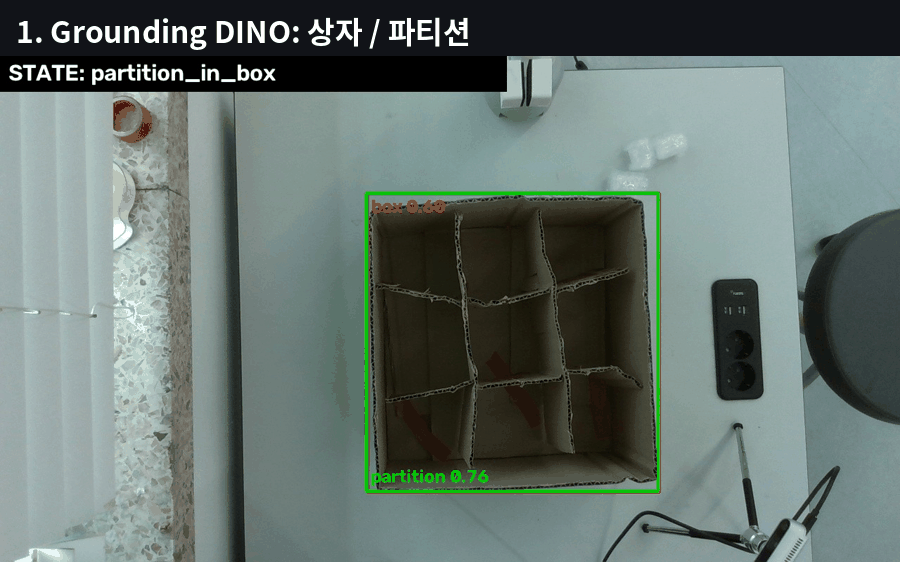

<sub>실제 실행 기록: Grounding DINO → VGGT 높이 → Canny+RANSAC 칸 분할 → DINOv3 칸 판정 → RF-DETR+SAM2 블록·파지</sub>

</div>

---

## 📌 목차
1. [미션](#-미션) · 2. [시스템 구조](#-시스템-구조) · 3. [기본과제 피드백 루프](#-기본과제-피드백-루프) · 4. [모니터링 대시보드](#-모니터링-대시보드)
5. [인식 결과](#-인식-결과) · 6. [기술 스택](#-기술-스택) · 7. [성능 요약](#-성능-요약) · 8. [빠른 시작](#-빠른-시작)
9. [저장소 구조](#-저장소-구조) · 10. [현장 체크리스트](#-현장-체크리스트) · 11. [진행 상황](#-진행-상황) · 12. [라이선스](#-라이선스)

---

## 🎯 미션

| 구분 | 내용 |
|---|---|
| 기본 과제 | 3×3 파티션 상자 + 뽁뽁이 블록 5개 — 비전으로 블록을 찾아 집고 빈 칸에 하나씩 넣기 |
| **통과 기준** | **5개 중 4개 이상 정상 안착 + 파티션 무너짐 없음** |
| 확장 과제 | 4×4 규격 대응 · 칸 여유 축소 · **삽입 실패 감지 → 자세 변경·재시도** · 속지 펼쳐 넣기 · 만재 상자 옮기기 |
| 평가 핵심 | 칸 크기·개수, 제품 형상이 바뀌어도 유연하게 대응하는가 |
| 일정 | 2026-10-09 (금) 11:00 ~ 10-10 (토) 18:00, 경북대 크리에이티브파크 |

**전략:** 좌표를 미리 정해 두지 않고, **매번 카메라로 상자·칸·블록을 새로 인식**하고, 넣은 뒤 **스스로 판정해 재시도**한다.

---

## 🧭 시스템 구조

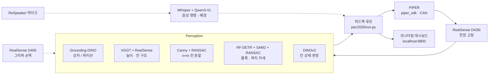

- **AI 모델**이 "무엇이 어디쯤 있는지" 찾고 → **기하 알고리즘**(RANSAC, Canny, 평면 맞춤)이 정확한 위치·각도·높이로 바꾸고 → **로봇 제어**가 움직인다.
- LLM/VLM은 제어 루프 밖(실패 원인 설명, 음성 명령)에서만 쓴다.

---

## 🔁 기본과제 피드백 루프

<div align="center"></div>

| 단계 | 장비 | 기술 | 실패 시 |
|---|---|---|---|
| 1. 상자 위치·높이 | D435i | Grounding DINO → RANSAC 테이블 평면 → 벽 높이 p99 | 파티션이 상자 밖 → 정지 |
| 2. 파티션 n×m · 빈 칸 | D435i | VGGT → Canny → 순차 RANSAC 직선 → SAM2+RANSAC 칸 정밀화 → DINOv3 | 재촬영 |
| 3. 블록 집기 | D435i → PiPER | RF-DETR → SAM2 → RANSAC 직사각형(중심·각도·폭) | 재시도 3회 |
| 4. 들어 올려 확인 | 그리퍼 폭 (+D405) | 엔코더 폭 / 손가락 사이 depth | → 3단계 |
| 5. 목표 칸 위 이동 | PiPER | z = 상자 높이 + 블록 높이 + 안전마진 | - |
| 6. 위치·파지 재확인 | D435i + D405 | 그리퍼 위치, 파지 유지, (예정) 비주얼 서보잉 | 보정 / → 3단계 |
| 7. 내려놓기·판정 | PiPER → D435i | DINOv3 칸 판정 (+depth 높이 변화) | 걸침 → 90° 재삽입 / 빈 칸 → 3단계 |

---

## 📺 모니터링 대시보드

`run.py`를 실행하면 자동으로 켜진다 → **http://localhost:8800** (같은 네트워크의 노트북에서도 접속 가능)

<div align="center">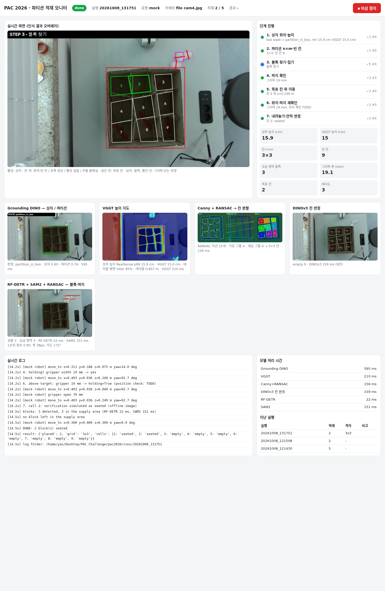</div>

- **실시간 화면**: 카메라 + 인식 오버레이(상자, 칸 상태 색, 목표 칸, 블록·그리퍼 방향, 현재 단계)
- **단계 진행 1–7** (성공 ✓ / 실패 ✗), 상자 높이·n×m·빈 칸·그리퍼 폭·재시도
- **모델 카드**: Grounding DINO · VGGT 높이 · Canny+RANSAC · DINOv3 · RF-DETR+SAM2+RANSAC · 넣은 뒤 판정
- 모델별 처리 시간, 실시간 로그, 지난 실행 목록, **비상 정지 버튼**

---

## 🔍 인식 결과

<table>
<tr>
<td width="50%">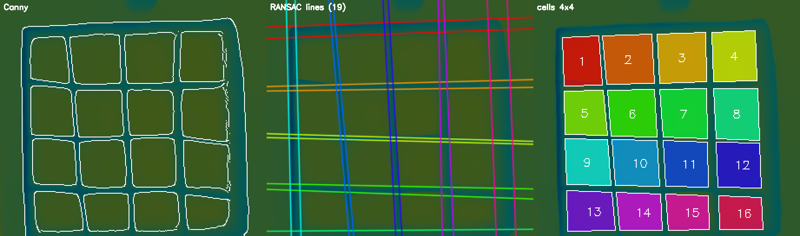<br><b>칸 분할</b> — VGGT 높이 → Canny → RANSAC 직선 → 4×4 자동</td>
<td width="50%">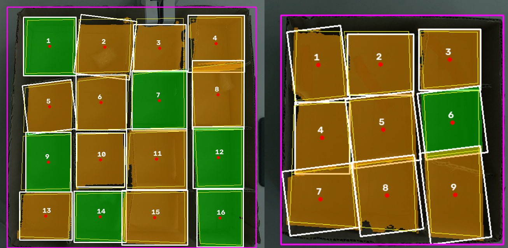<br><b>칸별 정밀화</b> — SAM2 + RANSAC 직사각형, 휜 칸막이도 추종</td>
</tr>
<tr>
<td>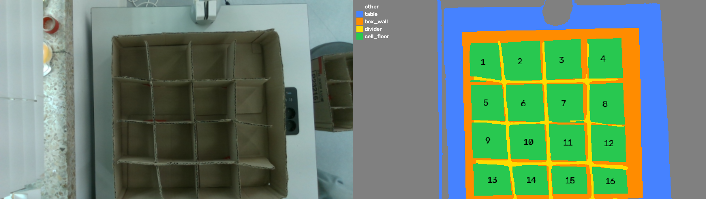<br><b>부재 분리</b> — 점군 라벨: 테이블 / 벽 / 칸막이 / 칸 바닥(1–16)</td>
<td>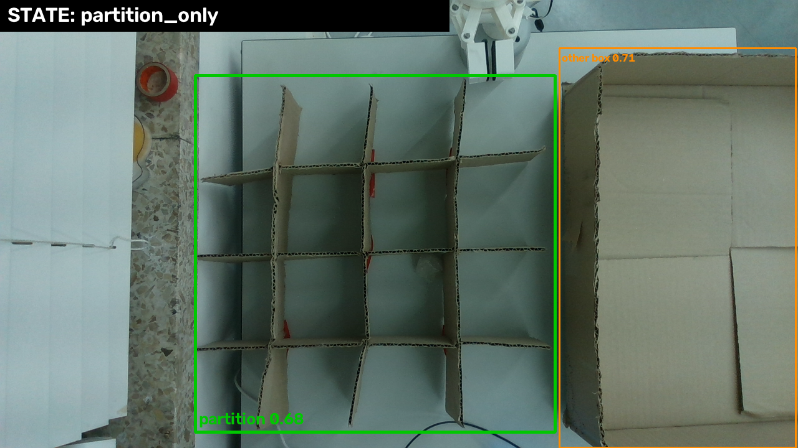<br><b>상자 / 파티션 구분</b> — Grounding DINO 장면 판정</td>
</tr>
<tr>
<td>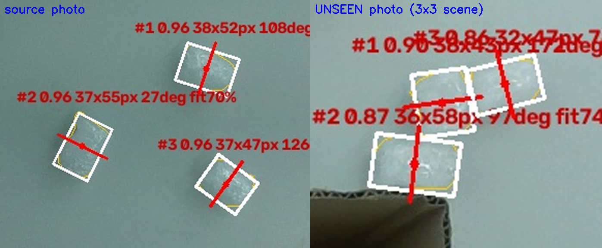<br><b>블록 파지</b> — RF-DETR → SAM2 → RANSAC 사각형, 빨간 선 = 그리퍼 닫는 방향</td>
<td>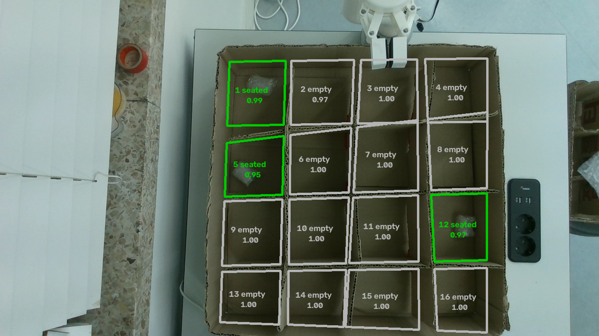<br><b>삽입 판정</b> — DINOv3 블라인드 테스트 16/16</td>
</tr>
<tr>
<td>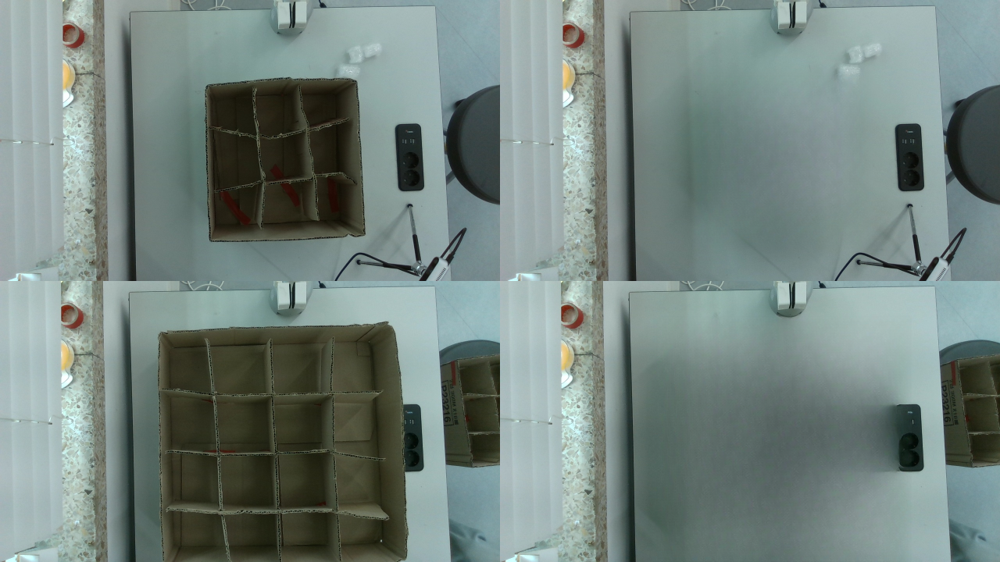<br><b>합성 데이터</b> — LaMa로 물체 제거 → 블록 복사·붙여넣기 (라벨링 0장)</td>
<td>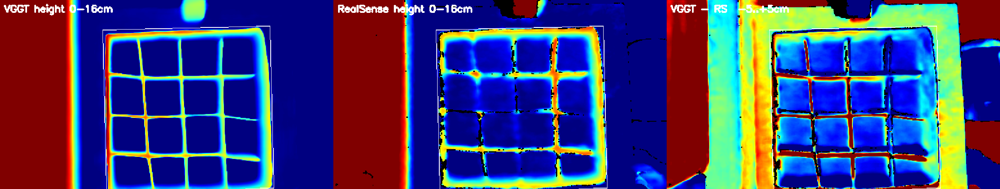<br><b>VGGT vs RealSense 높이</b> — 칸 구조는 VGGT, 높이 숫자는 RealSense</td>
</tr>
</table>

---

## 🧰 기술 스택

| 기술 | 기반 | 역할 |
|---|---|---|
| **Grounding DINO** | 텍스트-이미지 정렬 open-vocabulary 검출 | 상자·파티션 구분, 로봇 팔 제외, 자동 라벨 |
| **VGGT-1B-Commercial** | 사진 1장 → depth·점군 트랜스포머 | 얇은 칸막이까지 보이는 칸 구조 |
| **RealSense D435i / D405** | 능동 스테레오 depth | 실측 높이(m), VGGT 스케일, 근접 확인 |
| **RANSAC** (평면·직선·직사각형) | 무작위 샘플 + inlier 최대 | 테이블 기준면, 칸막이 직선, 블록·칸 사각형 |
| **Canny** | 밝기 기울기 엣지 | 칸막이 경계선 |
| **SAM 2.1** | 프롬프트 기반 분할 | 블록 외곽, 칸 안쪽 마스크 |
| **RF-DETR** | DINOv2 백본 + DETR, 합성 데이터로 미세조정 | 뽁뽁이 블록 검출 (~27 ms) |
| **DINOv3 + 로지스틱 회귀** | 자기지도 이미지 특징 + 선형 분류기 | 칸 상태: 빈 칸 / 정상 / 걸침 |
| **LaMa (IOPaint)** | 푸리에 합성곱 인페인팅 | 학습 데이터 자동 합성 |
| **piper_sdk** | CAN 1 Mbps, 컨트롤러 IK | PiPER 이동·그리퍼 |

자세한 설명: [`docs/tech_overview.md`](docs/tech_overview.md) · [`docs/update_2026-10-07.md`](docs/update_2026-10-07.md)

---

## 📊 성능 요약

| 항목 | 결과 | 조건 |
|---|---|---|
| 칸 분할 (n×m 자동) | 3×3 · 4×4 · 파티션 단독 모두 정답 | VGGT-1B-Commercial, RANSAC 허용오차 2.5 px |
| 칸별 정밀화 | 4×4 16/16 · 3×3 9/9 | SAM2 + RANSAC |
| 블록 검출 | 처음 보는 실제 사진 3/3 (0.86–0.90), 블록 없는 사진 오검출 0 | 합성 600장으로 학습, RF-DETR Medium @768 |
| 칸 상태 판정 | 사진 단위 교차검증 **98.0%**, 블라인드 테스트 **16/16** | DINOv3 + 로지스틱 회귀, 102칸 |
| 상자 높이 | 4×4 ≈ 12 cm · 3×3 ≈ 16 cm | RealSense p99 (자 실측 비교 예정) |
| 처리 시간 (RTX 3090) | Grounding DINO 595 · VGGT 210 · Canny+RANSAC 156 · DINOv3 159 · RF-DETR 22 · SAM2 151 ms | 모델은 시작 시 1회 로딩 (~10 s) |

---

## 🚀 빠른 시작

```bash
# 1) 설치 (venv: perception-main/ai_bubble/.venv)
bash setup/install.sh
sudo apt install -y can-utils ethtool v4l-utils
export HF_TOKEN=hf_...            # DINOv3 · VGGT-Commercial 승인 계정 (커밋 금지)
perception-main/ai_bubble/.venv/bin/python setup/get_models.py

# 2) 실행
cd pac2026
PY="env HF_HUB_OFFLINE=1 ../perception-main/ai_bubble/.venv/bin/python"
$PY run.py --image <사진.jpg> --depth <depth.raw>   # 오프라인 사진 + mock 로봇
$PY run.py --image ... --mock-fail-rate 0.4          # 실패·재시도 흐름 시험
$PY run.py                                           # 실시간 D435i + mock 로봇
$PY run.py --robot piper --max-blocks 1              # 실제 PiPER (CAN 활성화 후)
# 대시보드: http://localhost:8800
```

**PiPER 연결:** PiPER ─CAN─ 동봉 USB-CAN 어댑터 ─USB─ PC → `can0`
```bash
sudo bash <piper_sdk>/piper_sdk/can_activate.sh can0 1000000
perception-main/ai_bubble/.venv/bin/python robot_piper/piper_check.py   # 읽기 전용 확인 (움직이지 않음)
```

---

## 🗂 저장소 구조

```
YAX_PICKR/
├── pac2026/                실행 파이프라인 (run.py 하나로 1–7단계)
│   ├── run.py · config.yaml
│   └── pac/                types · cameras · models · perception · calib · robot · pipeline · runlog · dashboard
├── perception-main/        비전 모듈
│   ├── research/box_cells/ 칸 분할(box_lines), RANSAC 사각형(rect_fit), 합성(synth_blocks), VGGT
│   ├── ai_bubble/          블록 검출: 합성 데이터셋, RF-DETR 학습·평가·파지
│   ├── ai_failure/         칸 판정(DINOv3), 장면 판정, 높이 추정, 점군 라벨링, 칸 정밀화
│   └── (원본 FR5 perception 코드: 캘리브레이션, RANSAC 평면, 파지 서버)
├── robot_piper/            PiPER 읽기 전용 연결 확인
├── sim_tools/              PiPER 시뮬레이션 데모 (pick & place, 칸별 적재)
├── docs/                   기술 정리, 도표, 결과 이미지
├── setup/                  install.sh · requirements.txt · get_models.py
└── assets/                 README용 GIF
```

---

## ✅ 현장 체크리스트

- [ ] 카메라: **상자 전체가 컬러 화면 안**에 들어오게 설치, 촬영 시 로봇 팔은 화면 밖
- [ ] PiPER: CAN 활성화 → `piper_check.py`로 읽기 확인 → `config.yaml` ON SITE 값(`tcp_offset_m`, `down_rpy_deg`, `table_z_robot_m`)
- [ ] 캘리브레이션: 픽셀 → 로봇 좌표(`pac2026/calib/pixel_to_robot.json`), 전원 재투입마다
- [ ] 상자 높이 자로 실측 → 측정값과 비교
- [ ] 현장 조명으로 DINOv3 칸 분류기 재학습(수 초), 필요 시 RF-DETR 재학습(~20분)
- [ ] `--step partition` → `--robot piper --max-blocks 1` → 5개
- [ ] D405 USB 3 연결 확인(5000 Mbps), 케이블 스트레인 릴리프

---

## 🛠 진행 상황

| 상태 | 항목 |
|---|---|
| ✅ | 상자/파티션 판정, 상자 높이, n×m 칸 분할, 칸별 정밀화, 부재 분리, 블록 검출·파지, 칸 상태 판정, 실행 뼈대, 대시보드 |
| 🔶 | PiPER 제어(`PiperRobot`, 실기 미검증), 그리퍼 폭 파지 확인 |
| ⏳ | 현장 캘리브레이션 스크립트, D405 손목(파지 확인·비주얼 서보잉), 6단계 위치 확인, 블록 검출기 방해물 학습, 음성 명령(Whisper + Qwen3-VL), 파티션 무너짐 판정 |

---

## 📜 라이선스

모델 가중치는 저장소에 포함하지 않는다(`setup/get_models.py`로 원 출처에서 다운로드).
모든 모델은 상업적 사용이 가능한 버전으로 구성 — **VGGT는 반드시 `VGGT-1B-Commercial`** 사용.
상세: [`THIRD_PARTY_LICENSES.md`](THIRD_PARTY_LICENSES.md)

<div align="center"><sub>PICKR Lab · PAC 2026</sub></div>
