# 🤖 PAC 2026 · 효림엑스이 파티션 칸별 적재 — PICKR Lab 기술 정리

> 마지막 업데이트: 2026-10-06
> 대회: 2026-10-09(금) 11:00 ~ 10-10(토) 18:00, 경북대학교 크리에이티브파크
> 상태 표기: ✅ 구현·검증 완료 / 🔶 구현됨·추가 검증 필요 / 📝 설계만 완료 / ⏳ 예정

---

## 1. 미션 요약

**과제:** 파티션(속지)이 들어간 상자의 빈 칸에, 뽁뽁이로 감싼 블록을 비전으로 찾아 하나씩 집어 넣기.

| 구분 | 내용 |
|---|---|
| 기본 과제 | 3×3 파티션 상자 + 뽁뽁이 블록 5개 |
| **통과 기준** | **5개 중 4개 이상 정상 안착 + 파티션 무너짐 없음** |
| 확장 과제 | 4×4 규격 대응, 칸 여유 축소, **삽입 실패 감지 후 자세 변경·재시도**, 속지 펼쳐 넣기, 만재 상자 옮기기 |
| 평가 핵심 | 칸 크기·개수, 제품 형상이 바뀌어도 알고리즘·그리퍼 수정으로 유연하게 대응하는지 |
| 로봇 | WeGo(AgileX) PiPER + 평행 그리퍼 — **대회 당일 현장 지급** |

**우리 전략:** 사람이 미리 정해 둔 좌표가 아니라, **매번 카메라로 상자·칸·블록을 새로 인식**하고, 넣은 뒤 **스스로 성공/실패를 판정해 재시도**하는 시스템.

---

## 2. 하드웨어 구성

| 장비 | 역할 | 비고 |
|---|---|---|
| **WeGo PiPER** (6축, 반경 626 mm, 가반 1.5 kg) | 대회용 로봇 | CAN 1 Mbps(USB-CAN 동봉), `piper_sdk`(Python). 평행 그리퍼 0–70 mm |
| **Intel RealSense D435i** (상단 고정) | 위에서 내려다보는 메인 카메라 | 컬러 1280×720 + depth 848×480 |
| **ReSpeaker 4-Mic Array** | 음성 명령 입력 | 16 kHz 6채널, ch0 = 빔포밍된 음성 채널 |
| myCobot 280 (연습용) | 현장 전 동작·캘리브레이션 연습 | `/dev/ttyUSB0` 115200, `pymycobot` 연결 확인 |
| 개발 PC | 학습·추론 | RTX 3090 24 GB |

### PiPER 주의사항 (공식 GitHub 이슈 기준)
- 명령·피드백은 **6축 플랜지 기준** → 그리퍼 끝까지 약 136–145 mm 오프셋은 **우리 코드에서** 보정.
- 자세 단위 **0.001 mm / 0.001°**, 오일러 순서 **R = Rz·Ry·Rx**. IK는 컨트롤러가 수행(자기충돌 검사 없음).
- **전원을 다시 켜면 영점이 최대 ~1 cm 틀어질 수 있음**, 로봇 개체마다 2–3 cm 차이 보고 → **현장 캘리브레이션 필수**(10분 이내 절차 준비).
- `DisablePiper()` / `ResetPiper()`는 **팔이 힘이 빠져 떨어짐** → 실패 처리 로직에서 사용 금지.
- 그리퍼 벌림 폭 피드백 → **"블록을 쥐었나" 판정**에 사용(행정 파라미터 설정 필요).

---

## 3. 전체 시스템 구조

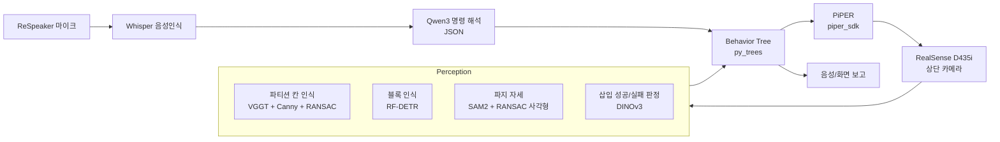

- **Vision:** 상자·칸·블록 인식, 파지 자세, 결과 판정
- **Language:** 음성 명령 → 정해진 형식(JSON)의 작업 지시
- **Action:** Behavior Tree가 검증된 동작(집기·넣기·확인·재시도)을 순서대로 실행
- 원칙: **LLM은 로봇을 직접 움직이지 않음.** 미리 정한 선택지·설정값만 채우고, 실제 동작은 BT가 수행.

---

## 4. Behavior Tree 📝 (설계 완료 · 구현 예정)

Python 스크립트(perception 모듈)를 BT 노드에서 호출하는 구조. 라이브러리는 `py_trees` 예정.

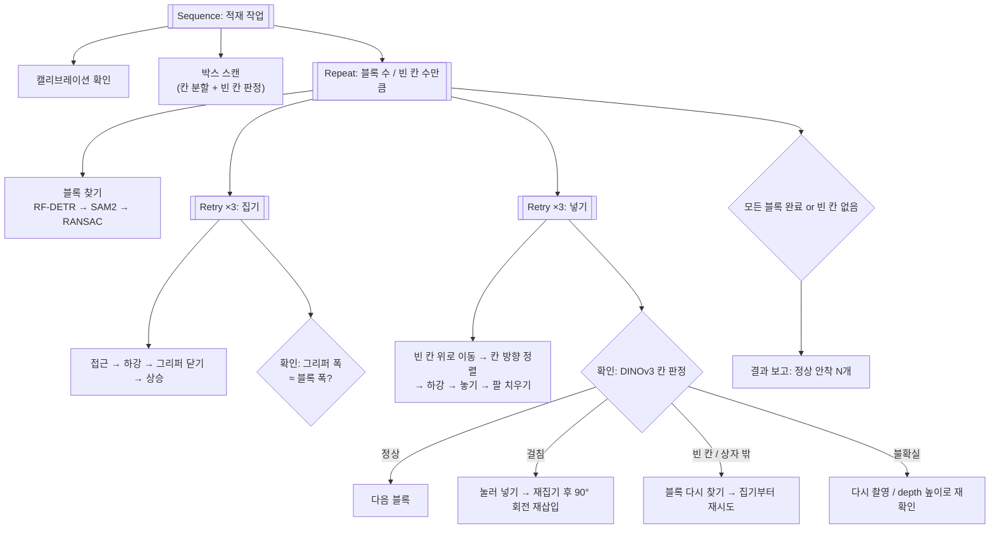

### 노드별 매핑

| BT 노드 | 호출 모듈 | 상태 |
|---|---|---|
| 박스 스캔 | `ai_failure/capture_cells.py` (Grounding DINO ROI → VGGT → `box_lines.detect`) | ✅ |
| 빈 칸 판정 | `ai_failure/predict_cells.py` (DINOv3 분류기) | ✅ |
| 블록 찾기 + 파지 자세 | `ai_bubble/detect_grasp.py` (`BlockGraspDetector`) | ✅ (픽셀 좌표) |
| 픽셀 → 로봇 좌표 | 자동 캘리브레이션(놓고 → 찍고 → 맞추기, 호모그래피) | ⏳ |
| 로봇 이동·그리퍼 | PiPER 래퍼 + mock(가짜 로봇) | ⏳ |
| 집기 성공 확인 | 그리퍼 폭 피드백 (+ 보조로 그리퍼 영역 비전) | ⏳ |
| 넣기 성공 확인 | DINOv3 칸 판정 (+ depth 높이 비교) | ✅ 판정기 / ⏳ BT 연결 |

---

## 5. 파티션 칸 인식 ✅

### 처리 흐름
1. **Grounding DINO** `"cardboard box."` → 상자 영역(ROI). 로봇 그리퍼가 상자에 겹쳐 있어도 상자만 고름.
2. **VGGT** (Meta, 이미지 1장 → depth) → depth를 RealSense 테이블 거리로 스케일 맞춤.
3. **테이블 평면 RANSAC** → 픽셀별 "테이블 위 높이".
4. 높이 3–7 cm 구간만 잘라서 **Canny 엣지**.
5. **순차 RANSAC 직선**(직선 찾기 → inlier 제거 → 반복, 박스 축 ±10°만 허용).
6. 직선을 가로/세로 · 위치별로 **그룹핑** → 바깥 그룹 = 벽, 안쪽 = 칸막이. 그룹 사이가 높으면(벽 안쪽 경사면) 병합, 화면 밖으로 잘린 벽은 박스 외곽선으로 대체.
7. 칸 수(rows × cols) **자동 결정** → 칸별 사각형.

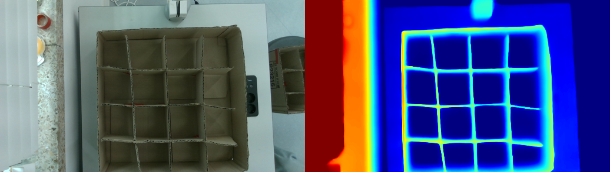
*VGGT가 RGB 한 장으로 만든 높이 지도 — 4×4 칸막이가 선명하게 보임.*


*왼쪽부터 Canny 엣지 / RANSAC 직선(그룹별 색) / 최종 칸 4×4.*

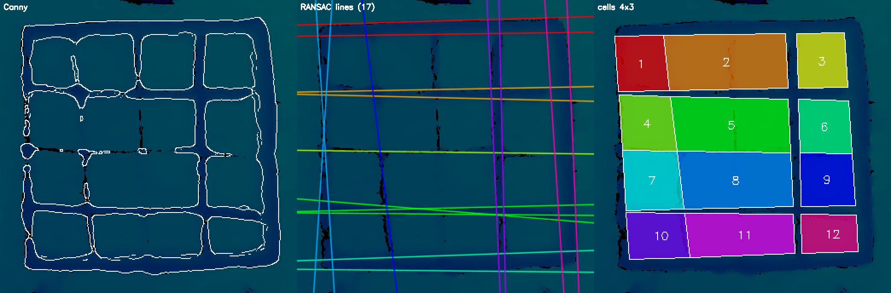
*같은 방법을 RealSense depth로 하면 얇은 칸막이를 놓쳐 4×3으로 틀림 → 칸 구조는 VGGT 사용.*

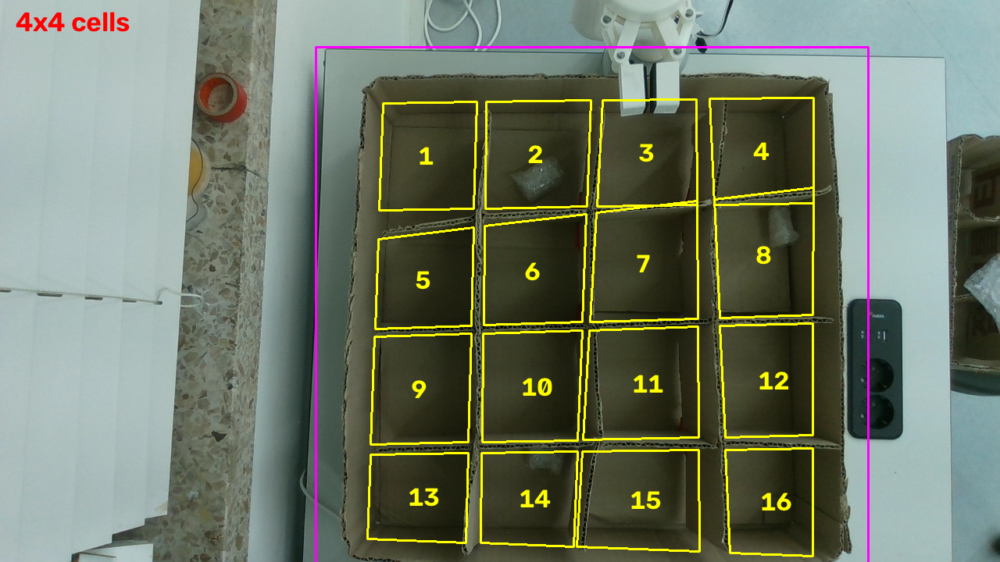
*분홍: Grounding DINO 상자 영역. 이 영역을 쓰기 전에는 그리퍼가 상자에 붙어 가짜 줄이 생겼음(5×4).*

### 결과
- 3×3 상자 2종, 4×4 상자 1종에서 칸 수 자동 판별 성공. 회전(±30°) 테스트 통과.
- RANSAC 난수 시드 5개 모두 같은 결과(재현성 확인).

---

## 6. 블록 인식 — 합성 데이터 + RF-DETR ✅

### 6-1. 학습 없이 시작: Grounding DINO + SAM2
- **Grounding DINO** `"bubble wrap."` → 블록 박스(신뢰도 ~0.5).
- **SAM2.1** 박스 프롬프트 → 박스 안쪽만 분할.

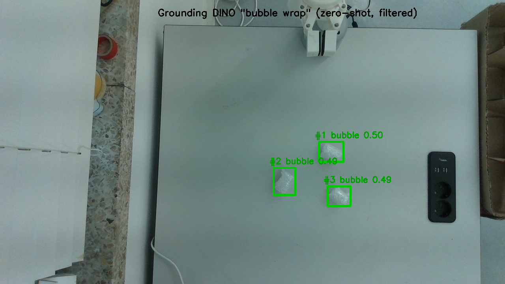

### 6-2. LaMa 인페인팅으로 학습 데이터 자동 생성
1. SAM2 마스크로 블록을 잘라냄.
2. **LaMa**(IOPaint)로 블록을 지워 빈 배경 생성.
3. 블록 조각을 무작위 위치·회전(0–360°)·크기(0.7–1.4배)·밝기로 다시 붙임 + 이미지 전체 확대/축소(0.75–1.6배, 카메라 높이 변화 흉내).
4. 붙인 위치 = 정답 라벨 → **사람 라벨링 0장**.


*왼쪽 원본 / 오른쪽 LaMa로 상자를 지운 결과.*

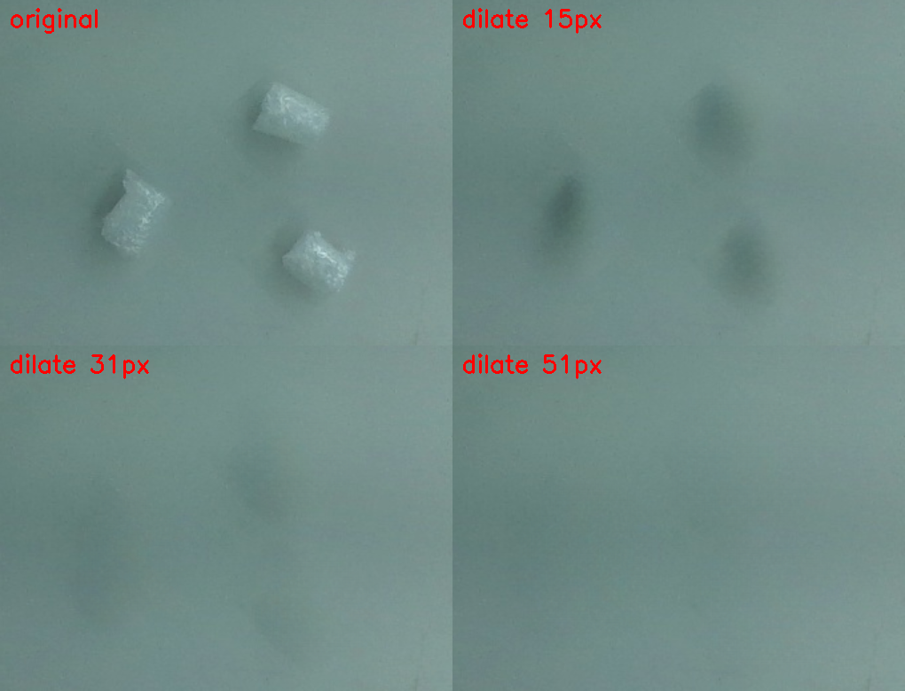
*마스크 여유가 작으면(15px) 회색 그림자 얼룩이 남음 → 51px로 해결.*

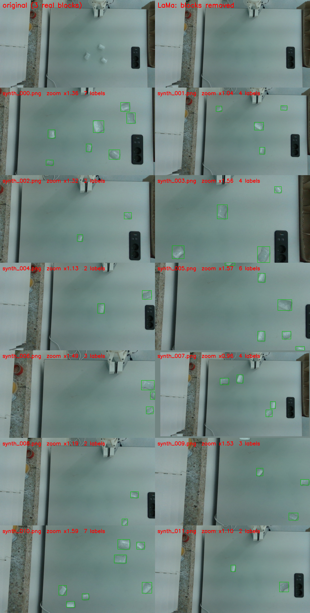
*맨 위: 원본 / LaMa 배경. 아래: 합성 이미지와 자동 라벨(초록).*

### 6-3. RF-DETR 학습
| 항목 | 값 |
|---|---|
| 모델 | RF-DETR Medium, 해상도 768 |
| 데이터 | 학습 600장(박스 2,563) / 검증 100장 — 모두 합성 |
| 학습 | 30 epoch, RTX 3090 약 17분 |
| 합성 검증 | mAP@50:95 0.971 (같은 분포라 참고용) |
| **처음 보는 실제 사진** | **블록 3/3 검출(0.86–0.90)**, 블록 없는 4×4 사진 **오검출 0** |
| 속도 | RF-DETR ~27 ms / 장 |

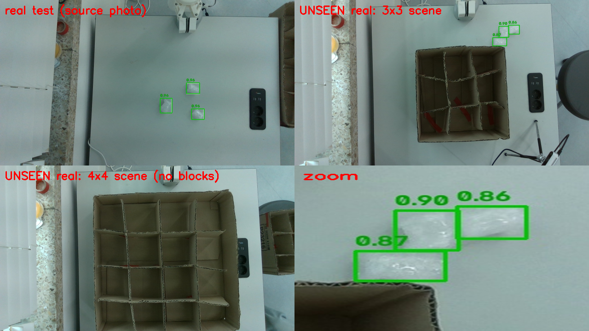

---

## 7. 파지 자세 — SAM2 + RANSAC 직사각형 ✅

**흡착(원본 FR5 코드) → 평행 집게(PiPER)로 변경**에 맞춰 새로 작성.

1. RF-DETR 박스 → **SAM2** 분할(박스 안쪽만).
2. 외곽선에 **RANSAC 직사각형**: 이웃한 외곽점 두 개로 변 방향 후보 → 네 변 근처 inlier가 가장 많은 방향 선택 → 변별 중앙값으로 재보정. 뽁뽁이의 울퉁불퉁한 외곽에 끌려가지 않음.
3. **짧은 변 방향으로 그리퍼를 닫음**(빨간 선) → 중심, 각도, 벌림 폭 출력.

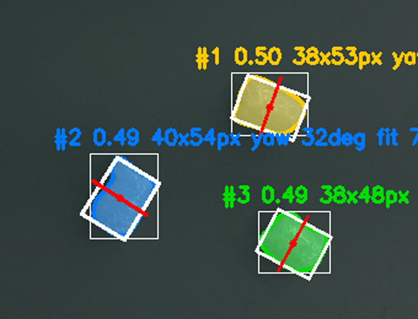


*오른쪽(처음 보는 사진): 붙어 있는 블록도 개별 분리. 단, #1처럼 정사각형에 가까우면 옆 블록과 손가락이 부딪힐 수 있음 → **손가락 공간 검사 추가 예정**.*

| 처리 | 시간 |
|---|---|
| RF-DETR | ~27 ms |
| SAM2.1-large | ~160 ms |

---

## 8. 삽입 성공/실패 판정 — DINOv3 ✅

### 방법
- 칸 인식 결과로 **칸마다 주변 칸막이 25% 여유를 두고** 잘라 224×224로 정규화 → 3×3, 4×4 공통.
- **DINOv3 ViT-B/16**(고정) 특징 = CLS + 칸 중앙 패치 평균(1536차원) → **로지스틱 회귀**.
- 클래스: **빈 칸 / 정상 안착 / 걸침**(칸막이·테두리 위에 얹힘). (무너짐은 데이터 수집 예정)
- 안전장치: 확신도 0.7 미만 → **"불확실"**(재촬영·depth 재확인), 칸이 화면 밖으로 잘림 → **"안 보임"**.

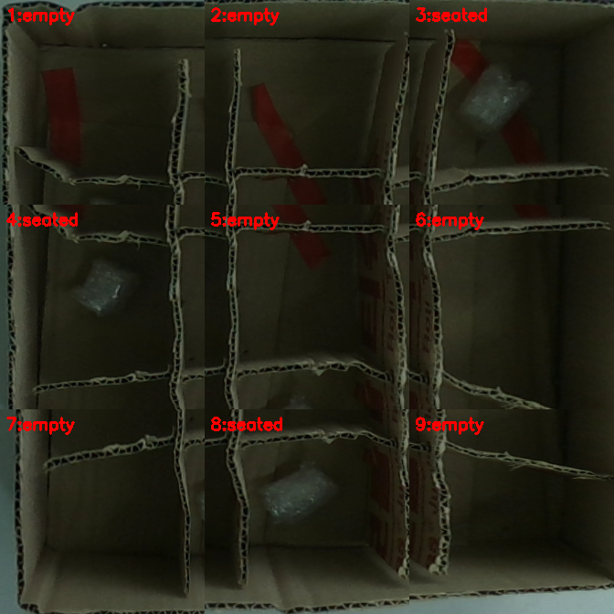
*칸별로 잘라 라벨링한 학습 데이터 예시.*

### 결과
| 항목 | 값 |
|---|---|
| 학습 데이터 | 칸 102개(사진 10장) — 손으로 블록을 놓아 가며 수집, 학습 몇 초 |
| 사진 단위 교차검증 | **98.0%** |
| 블라인드 테스트(4×4, 정답 모르는 상태로 판정) | 1회차 블록 3/3, 2회차 보이는 칸 2/2, **3회차 16/16** |
| 속도 | 칸당 ~10 ms |


*3회차 블라인드 테스트: 1·5·12번 정상 안착 판정 — 실제와 일치.*

### 테스트하면서 고친 것
- 4×4로 상자를 바꾸면 칸 위치 재계산 필요 → `capture_cells.py` 1회 실행.
- 상자 아래 줄이 화면 밖으로 잘리면 블록이 안 찍힘 → "안 보임" 처리 + **카메라 설치 시 상자 전체가 화면 안에 들어오게**.

---

## 9. 보조 기능

### 로봇 팔 인식 (Grounding DINO, 학습 없음)
`"robot gripper."` 0.49 / `"robot arm."` 0.39로 검출. 촬영 순간 팔이 작업 영역을 가리는지 확인하는 용도. (팔 위치 자체는 관절 각도로 정확히 알 수 있으므로 비전은 보조.)

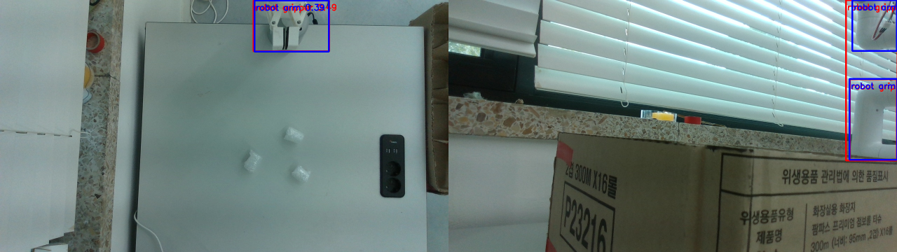

### 음성 VLA ⏳ (모듈형)
```
🗣 "블록 세 개를 왼쪽 위 칸부터 채워 줘"
→ Whisper(로컬, 한국어) → Qwen3: {"task":"fill","count":3,"start":"top_left"}
→ Perception → Behavior Tree → 🔊 "3개 모두 넣었어요. 1, 2, 3번 칸 정상 안착."
```
- 엔드투엔드 VLA(OpenVLA·π0·SmolVLA)는 PiPER 시연 데이터가 필요 → 대회 전 수집 불가 → **향후 확장**으로 제시.
- ReSpeaker 연결·녹음 확인 완료(ch0 사용).

### 실패 판단 보조 (VLM)
Qwen3-VL-8B(로컬 보유)로 애매한 칸을 2차 판정 + 실패 이유를 말로 설명 — 데모·발표용.

---

## 10. 사용 기술 · 라이선스

| 기술 | 용도 | 라이선스 / 상업 사용 |
|---|---|---|
| **RF-DETR** (Roboflow) | 블록 검출 | Apache 2.0 ✅ |
| **Grounding DINO** base | 상자·블록·로봇 팔 검출(학습 없이), 자동 라벨 | Apache 2.0 ✅ |
| **SAM 2.1** (Meta) | 분할 | Apache 2.0 ✅ |
| **DINOv3** ViT-B/16 (Meta) | 칸 상태 판정 | DINOv3 License — 상업 사용 ✅ (군사·무기·ITAR 금지, 재배포 시 라이선스 동봉). HF 수동 승인 후 다운로드 |
| **VGGT** (Meta) | RGB → depth (칸 구조) | 코드 ✅ / 현재 가중치 `VGGT-1B` **비상업** → `VGGT-1B-Commercial`로 교체 필요 |
| **LaMa** / IOPaint | 합성 데이터용 인페인팅 | Apache 2.0 / MIT ✅ |
| OpenCV (Canny, RANSAC 직접 구현) | 칸막이 직선 | Apache 2.0 ✅ |
| Qwen3-VL-8B / Qwen3-4B | 명령 해석, 2차 판정 | (확인 예정) |
| Whisper | 음성인식 | (설치 예정) |
| py_trees | Behavior Tree | (설치 예정) |

모든 모델은 **로컬 GPU에서 무료·오프라인** 실행.

---

## 11. 남은 작업 (우선순위)

1. ⏳ **픽셀 → 로봇 좌표**: 자동 캘리브레이션(로봇이 블록을 격자 위치에 놓고 → 카메라로 찍고 → 호모그래피). myCobot으로 연습 → 현장 PiPER에 그대로 적용.
2. ⏳ **높이 정확도**: `pyrealsense2`로 depth scale·intrinsics 확보, 높이 오류 원인 확인.
3. ⏳ **PiPER 래퍼 + mock**: 로봇 없이 BT 전체 흐름 검증.
4. ⏳ **Behavior Tree 구현**(py_trees) + 재시도 로직.
5. ⏳ 손가락 공간 검사(붙은 블록·상자 테두리 회피).
6. ⏳ 음성 VLA(Whisper + Qwen3).
7. ⏳ 파티션 무너짐 판정(DINOv3 넣기 전후 패치 특징 비교).

### 현장 체크리스트
- [ ] 상자 **전체가 컬러 화면 안**에 여유 있게 들어오도록 카메라 설치
- [ ] 촬영 시 **로봇 팔은 화면 밖 대기 자세**
- [ ] 로봇 전원 켤 때마다 캘리브레이션
- [ ] 현장 조명에서 칸 사진 2–3장 → DINOv3 분류기 재학습(몇 초)
- [ ] (필요 시) 현장 블록 사진으로 합성 → RF-DETR 재학습(~20분)

---

## 12. 코드 위치 · 실행

```
perception-main/
├── research/box_cells/     칸 인식(box_lines.py), RANSAC 사각형(rect_fit.py), 합성(synth_blocks.py), VGGT(vggt_cloud.py)
├── ai_bubble/              블록 검출: make_dataset.py, train.py, eval_real.py, detect_grasp.py, output/(RF-DETR 가중치)
├── ai_failure/             삽입 판정: capture_cells.py, label_round.py, train_classifier.py, predict_cells.py, model/
└── data/                   실험 결과 이미지, VGGT 점군(PLY)
```

```bash
cd perception-main/ai_failure
# 상자를 놓을 때 1번: 칸 위치 계산
HF_HUB_OFFLINE=1 ../ai_bubble/.venv/bin/python capture_cells.py --name box
# 칸별 판정
HF_HUB_OFFLINE=1 ../ai_bubble/.venv/bin/python predict_cells.py --cells data/box_cells.json

cd ../ai_bubble
# 블록 검출 + 파지 자세
HF_HUB_OFFLINE=1 .venv/bin/python detect_grasp.py 사진.jpg
```
모든 도구는 `ai_bubble/.venv` 하나에서 실행(RF-DETR, VGGT, DINOv3, Grounding DINO, SAM2).
