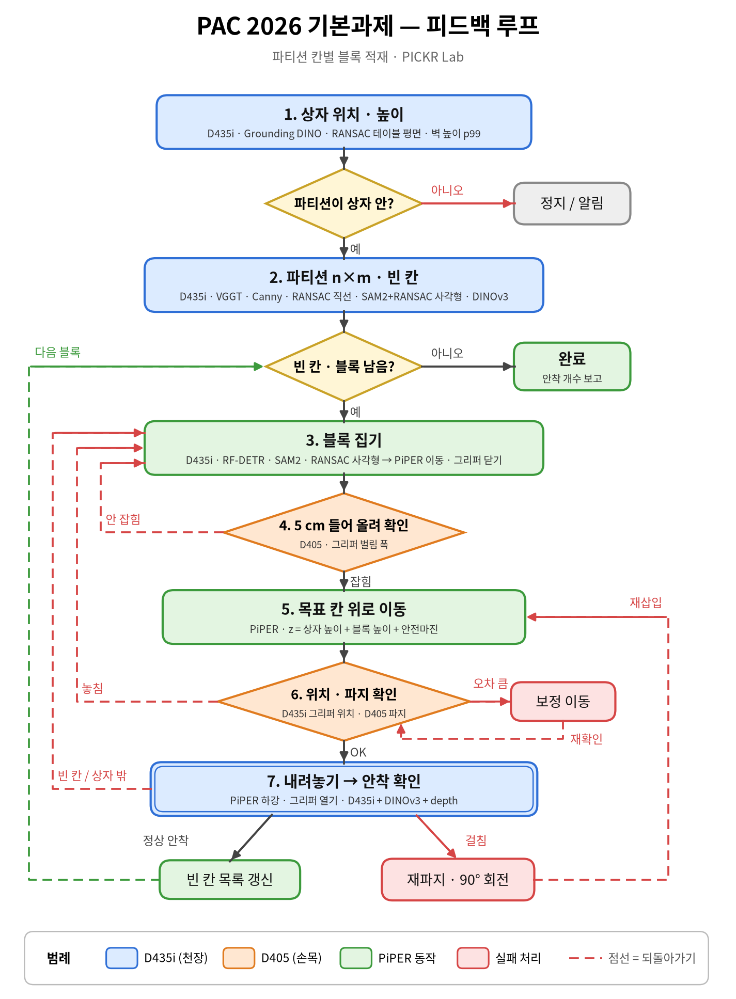
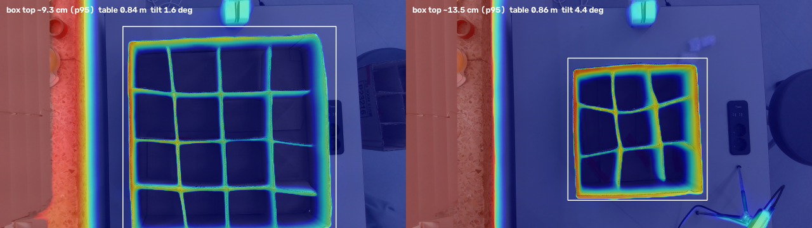
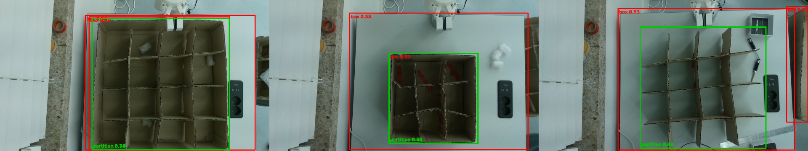
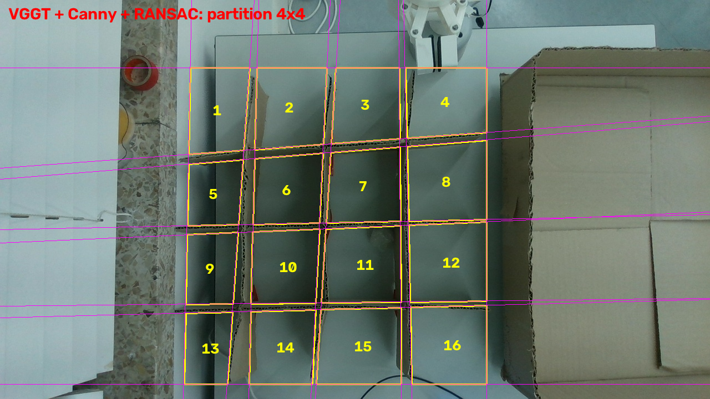

---

# 🆕 업데이트 2026-10-07 — 과제 루프 · 높이/크기 추정 · 부재 분리 · 상자/파티션 구분

> 이 섹션은 위 기술 정리에 이어서 추가된 내용입니다. 상태 표기: ✅ 동작 확인 / 🔶 동작·검증 필요 / ⏳ 예정

---

## 13. 기본과제 피드백 루프

*색 = 장비(파랑 D435i 천장, 주황 D405 손목, 초록 PiPER 동작, 빨강 실패 처리). 점선 = 되돌아가기.*

### 단계별 장비 · 기술

| 단계 | 장비 | 기술 (순서대로) | 결과물 | 확인 / 피드백 |
|---|---|---|---|---|
| 1. 상자 위치·높이 | D435i (RGB+depth) | Grounding DINO 상자·파티션 영역 → RealSense depth → RANSAC 테이블 평면 → 벽 높이 p99 → 픽셀→로봇 좌표 | 상자 위치·회전·**높이(4×4 약 12 cm)** | 파티션이 상자 안에 없으면 정지·알림 |
| 2. 파티션 n×m · 빈 칸 | D435i (RGB) | VGGT depth → 높이 3–7 cm 구간 Canny → 순차 RANSAC 직선·그룹핑 → n×m 자동 → SAM2+RANSAC 사각형 칸별 정밀화 → DINOv3 빈 칸 판정 → RealSense 스케일 | 칸별 중심·각도·크기, 빈 칸 목록 | 칸 수 이상·판정 불확실 → 재촬영 |
| 3. 블록 집기 | D435i → PiPER | RF-DETR 검출 → SAM2 분할 → RANSAC 직사각형(중심·집는 각도·폭) → 좌표 변환 + TCP 오프셋 → EndPoseCtrl → GripperCtrl 닫기 | 블록 파지 | 그리퍼 폭 ≈ 0 → 재시도 |
| 4. 5 cm 들어 올려 확인 | D405 + 그리퍼 피드백 | 그리퍼 벌림 폭 / D405 RGB 손가락 사이 블록 유무 / D405 depth | 잡힘·안 잡힘 | 안 잡힘 → 3단계 |
| 5. 목표 칸 위로 이동 | PiPER | 빈 칸 선택 → 칸 중심 + 칸 방향 회전 → z = 상자 높이 + 블록 높이 + 안전마진 | 칸 위 대기 | - |
| 6. 위치·파지 재확인 | D435i + D405 | D435i 그리퍼 위치(로봇 자세 투영, 보조로 Grounding DINO) / D405 파지 확인 / (추천) D405로 칸 재정렬 | 위치 오차, 파지 상태 | 오차 큼 → 보정 이동 / 놓침 → 3단계 |
| 7. 내려놓기 → 안착 확인 | PiPER → D435i | 하강 → 그리퍼 열기 → 상승 → DINOv3 칸 판정 + depth 바닥 높이 변화 → 빈 칸 목록 갱신 | 정상·걸침·빈 칸 | 걸침 → 재파지·90° 회전 / 빈 칸·상자 밖 → 3단계 / 정상 → 다음 블록 |

---

## 14. 기술별 기반 · 역할

### 센서 · 기본 측정
| 기술 | 기반 (원리) | 우리 역할 | 단계 |
|---|---|---|---|
| RealSense D435i depth | 적외선 패턴 투사 + 두 카메라 시차(능동 스테레오) | 테이블·상자·칸 바닥 실측 높이, VGGT 스케일 기준 | 1, 2, 7 |
| RealSense D405 depth | 근거리(약 7–50 cm) 최적 스테레오 + 같은 센서 RGB | 그리퍼 근처 블록 유무, 칸 정렬 정밀 확인 | 4, 6 |
| 그리퍼 벌림 폭 피드백 | 그리퍼 모터 엔코더 (GetArmGripperMsgs) | 닫은 폭으로 놓침/잡음 판정 | 3, 4, 6 |

### 인식 AI 모델
| 기술 | 기반 (모델·원리) | 우리 역할 | 단계 |
|---|---|---|---|
| Grounding DINO | DINO 검출기 + 텍스트-이미지 정렬(open-vocabulary) | 상자·파티션을 따로 찾기, 로봇 팔 제외, 그리퍼 위치 보조 | 1, 6 |
| VGGT (Meta) | 3D 학습 트랜스포머, 사진 1장 → depth·점군 | 얇은 칸막이까지 보이는 칸 구조 (크기는 RealSense로 맞춤) | 2 |
| SAM2 (Meta) | 박스·점 프롬프트 범용 분할 | 블록 외곽, 칸별 안쪽 영역 마스크 | 2, 3 |
| RF-DETR (Roboflow) | DINOv2 백본 + DETR 헤드, 합성 데이터로 학습 | 뽁뽁이 블록 검출 (~27 ms, 신뢰도 ~0.9) | 3, 4 |
| DINOv3 (Meta) + 로지스틱 회귀 | 자기지도 이미지 특징 + 선형 분류기 | 칸 판정: 빈 칸 / 정상 / 걸침 (0.7 미만 불확실) | 2, 7 |

### 기하 알고리즘
| 기술 | 기반 (원리) | 우리 역할 | 단계 |
|---|---|---|---|
| RANSAC 평면 | 무작위 3점 평면 후보 → 가장 많은 점이 붙는 평면 | 상자 주변 테이블 = 높이 0 기준 (수평면만 허용) | 1, 2 |
| 백분위수 p99 | 상위 1% 높이, 최댓값보다 잡음에 강함 | 상자 벽 높이 | 1 |
| 높이 구간 자르기 | 테이블 위 3–7 cm만 남김 | 벽·칸막이 중간 높이 윤곽만 추출 | 2 |
| Canny 엣지 | 밝기 기울기 급한 곳 검출 | 칸막이 양면 경계선 | 2 |
| 순차 RANSAC 직선 + 그룹핑 | 직선 찾기 → 점 제거 → 반복, 방향·위치로 묶음 | 칸 개수 n×m 자동, 칸 경계 | 2 |
| RANSAC 직사각형 | 이웃 외곽점으로 방향 후보 → 네 변 inlier 최대 | 블록 중심·집는 각도·폭 / 칸별 중심·회전·크기 | 2, 3 |
| 호모그래피 · 캘리브레이션 | 평면 대응점 좌표 변환 | 카메라 픽셀 → 로봇 좌표 (⏳ 미완성) | 1, 3, 6 |

### 로봇 제어
| 기술 | 기반 | 우리 역할 | 단계 |
|---|---|---|---|
| piper_sdk EndPoseCtrl | 목표 말단 자세 → 컨트롤러가 IK 계산 | 블록 위·칸 위 이동 | 3, 5, 6, 7 |
| TCP 오프셋 보정 | 플랜지 → 그리퍼 끝 좌표 변환 (~13.6–14.5 cm) | 그리퍼 끝을 목표점에 | 3, 5, 7 |
| 안전 높이 계획 | z = 상자 높이 + 블록 높이 + 마진 | 이동 중 벽·칸막이 충돌 방지 | 5 |
| piper_sdk GripperCtrl | 벌림 폭(0.001 mm)·힘 지정 | 집기·놓기 | 3, 7 |

### 학습 데이터 준비 (대회 전)
| 기술 | 기반 | 역할 |
|---|---|---|
| LaMa (IOPaint) | 푸리에 합성곱 인페인팅 | 블록을 지워 빈 배경 생성 |
| 복사-붙여넣기 합성 | SAM2 마스크로 자른 블록을 위치·회전·크기 바꿔 붙이기 | 자동 라벨 RF-DETR 학습 데이터 600장 |

---

## 15. 상자 높이 · 칸 크기 추정 ✅🔶

**방법:** Grounding DINO 상자 영역 → 상자에 바짝 붙은 테이블 띠(상자 크기의 2–12%)로 RANSAC 평면 → 평면 법선 방향 높이(카메라 기울기 무관) → 벽 점들의 p99 = 상자 높이. 칸 크기는 칸 꼭짓점 광선을 테이블 위 5 cm 평면과 교차시켜 계산(블록이 통과하는 입구 크기).

| 상자 | 상자 높이 (추천: RealSense) | 바깥 크기 | 칸 크기 (입구) |
|---|---|---|---|
| 4×4 | **약 12 cm** (12.2 / 12.4) | 약 53 × 51 cm | 약 10 × 10 cm |
| 예전 3×3 | 약 16 cm (RS 16.2 / VGGT 16.3) | 약 33 × 34 cm | 5.4–10.4 cm (직접 만든 상자라 불균일) |

*VGGT 점군 + RealSense 스케일로 만든 높이 지도 (왼쪽 4×4, 오른쪽 3×3). 벽·칸막이 높음, 칸 바닥·테이블 낮음.*

> ⚠️ 실측(자) 비교 전입니다. 4×4 상자 벽 높이를 재서 RealSense 12 cm를 확정해야 합니다.

---

## 16. RealSense vs VGGT 비교 🔶

*왼쪽 VGGT / 가운데 RealSense(상자 외곽 호모그래피로 정렬) / 오른쪽 차이. 칸막이 빨강 = RealSense가 놓침, 칸 안쪽 파랑 = VGGT가 깊게 봄.*

| 항목 (4×4) | RealSense | VGGT | 결론 |
|---|---|---|---|
| 테이블 | −0.4 cm | 0.1 cm | 둘 다 정확 |
| 상자 높이 (벽 p99) | **12.4 cm** (반복 측정 일치) | 15.1 cm (영역 따라 11.4–15.1) | RealSense |
| 칸막이 (중앙값) | 3.0 cm (얇아서 놓침) | 8.8 cm | VGGT |
| 칸 바닥 (중앙값) | **+0.8 cm** | −2.6 cm (테이블보다 낮음 → 불가능) | RealSense |
| 4×4 칸 판별 | 4×3 (오답) | **4×4** | VGGT |

**역할 분담:** 칸 구조(칸막이 위치, 칸 개수) = **VGGT** / 높이 숫자(상자 높이, 칸 바닥) = **RealSense** / 칸 크기 = VGGT 형상 + RealSense 스케일

---

## 17. 부재 분리 (점군 라벨링) ✅

VGGT 점군의 점마다 라벨: **테이블 / 상자 벽 / 칸막이 / 칸 바닥(+칸 번호) / 기타**. 저장: `points_labeled.ply`(라벨 색), `points_rgb.ply`(원래 색), `points_labeled.npz`(좌표·라벨·칸 번호·높이).

*파랑 테이블 · 주황 상자 벽 · 노랑 칸막이 · 초록 칸 바닥(1–16) · 회색 기타.*

---

## 18. 칸별 정밀화 — SAM2 + RANSAC 직사각형 ✅

직선 격자는 상자 전체를 가로지르는 직선이라 휘거나 기운 칸막이를 못 따라감 → 칸마다 SAM2(칸 중심 점 + 칸 영역 박스) → 후보 중 격자와 가장 잘 겹치는 마스크 선택, 칸 밖으로 새는 부분 제거, 블록 구멍 메움 → RANSAC 직사각형.

*흰 사각형 = SAM2+RANSAC, 노란 선 = 직선 격자. 칸마다 기울기를 따라감. 4×4 16/16, 3×3 9/9 성공.*

**결과물:** 칸별 중심·회전각·가로세로 → 블록을 넣을 **목표 위치와 그리퍼 회전각**.

---

## 19. 상자 / 파티션 구분 (Grounding DINO) ✅

| 프롬프트 | 대상 | 결과 |
|---|---|---|
| "grid of cardboard dividers." | 파티션 | 3장면 모두 확실 (0.65–0.78) |
| "cardboard box." | 상자 | 상자 있으면 OK, 상자 없으면 흰 테이블을 상자로 오인 → 파티션과의 관계로 선택 |

*빨강 상자 / 초록 파티션. 파티션이 상자 안이면 두 박스가 거의 겹침 → 벽/칸막이 구분은 부재 분리(17번)가 담당.*

| 판정 | 조건 | 다음 동작 |
|---|---|---|
| partition_in_box | 파티션을 감싸며 크기 비슷한(≤1.35배) 상자 | 블록 적재 시작 |
| partition_only | 파티션만, 감싸는 상자 없음 (옆에 빈 상자 = 다른 상자) | 확장과제 "속지 넣기" |
| empty_box | 상자만 | 파티션 필요 |

*실제 판정: partition_only — 파티션(초록)과 옆 빈 상자(주황, other box)를 따로 인식.*

---

## 20. 파티션 단독 칸 인식 (VGGT + Canny + RANSAC) ✅

상자 없이 테이블에 세운 파티션도 4×4로 정확히 인식. 벽이 없는 바깥 칸은 파티션 끝선을 경계로 처리. 확장과제 "속지 넣기"의 파티션 중심·회전각(약 3°)·크기 계산에 활용.

---

## 21. D405 (손목 카메라)를 다는 이유

| 위 카메라(D435i, ~85 cm)의 한계 | D405가 해결 |
|---|---|
| PiPER 영점 오차(전원 재투입 시 최대 ~1 cm, 개체 간 2–3 cm) vs 칸 여유 한쪽 2–3 cm | 넣기 직전 칸을 가까이서 보고 위치 보정 (비주얼 서보잉) — 가장 큰 이유 |
| 블록이 작게 보임(40–50 px), depth 높이 ~2 cm만 잡힘 | 20–30 cm에서 블록 모양·높이·각도 정밀 측정 |
| 얇은 칸막이를 depth가 놓침 | 가까이서는 칸막이까지 depth로 보임 |
| 칸 안쪽이 벽에 가림 | 칸 바로 위에서 수직으로 내려다봄 → 안착 판정 확실 |
| 블록이 그리퍼에 있는지 팔에 가려 안 보임 | 손가락 사이 블록 확인 |

**준비 필요:** eye-in-hand 캘리브레이션(기존 FR5용 코드 → PiPER용 수정), 거치대(3D 프린팅), 최소 거리 7 cm 이상, 케이블 정리.

---

## 22. 남은 작업 (업데이트)

- [ ] 4×4 상자 높이 실측(자)으로 RealSense 12 cm 확정
- [ ] pyrealsense2 설치 → depth scale·intrinsics 확인, 컬러-depth 정렬
- [ ] 픽셀 → 로봇 좌표 캘리브레이션 (현장 10분 절차)
- [ ] PiPER 래퍼 + mock → Behavior Tree(py_trees)로 1–7단계 연결
- [ ] D405 거치대 + eye-in-hand 캘리브레이션, "잡고 있나" 판정기
